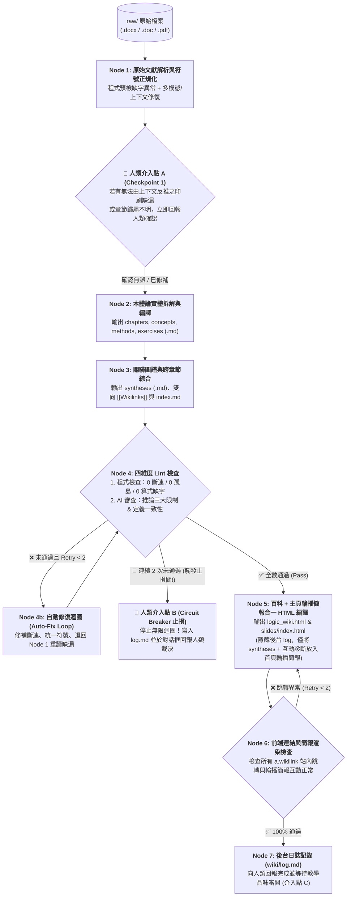

# AGENT.md — 哲學邏輯學 LLM Wiki 知識庫與教學簡報系統規範

> **專案名稱**：哲學邏輯學（Philosophical Logic）章節講義與練習題 LLM Wiki 知識庫  
> **架構參考**：Andrej Karpathy — *LLM Wiki: A pattern for building personal knowledge bases using LLMs*  
> **核心目標**：將邏輯學章節講義、補充資料、課後習題與歷屆小考/期中考卷（PDF / DOC / DOCX）透過結構化的 **Graph + 帶止損閥的 Loop 自動化工作流**，轉化為持續累積、雙向連結的 Obsidian Markdown 知識庫（`wiki/`），並編譯為**「百科全書主知識庫 + 主頁『最熱時事輪播式』跨章節綜合與互動診斷簡報」合一的單一 HTML 系統**（`logic_wiki.html` / `slides/index.html`）。

---

## 一、三層式系統架構 + 百科/簡報合一展示層

本系統遵循 Karpathy 的 LLM Wiki 三層架構，並將前端展示層設計為「百科全書詞條檢索 + 首頁熱門輪播教學簡報」二合一架構（**LLM Wiki 後台架構與 `log.md` 僅保留於後台檔案，絕不混入前端教學畫面**）：

1. **原始文獻層 (`raw/`) — Immutable Source of Truth**
   - 存放使用者提供的邏輯學章節講義、補充講義、課堂習題解答、小考與期中考解答（`.pdf`, `.doc`, `.docx` 共 33 份唯讀檔案）。
   - **唯讀原則**：Agent 僅能讀取與解析 `raw/` 中的檔案，**嚴禁修改或刪除**任何原始檔案。
2. **知識庫層 (`wiki/`) — Persistent, Compounding Artifact**
   - 由 Agent 全權維護的 Markdown 知識圖譜（共 30 篇核心知識頁 + `index.md` + `log.md`），採用 Obsidian 標準的 `[[Page Name]]` Wikilinks 語法進行跨頁面雙向連結。
3. **規範與控制層 (`AGENT.md`) — The Schema & Workflow Engine**
   - 定義目錄結構、命名與語言慣例、各節點輸入/輸出檔案、三層檢查機制（程式 / AI / 人類）、人類介入點（Human-in-the-Loop）與錯誤退回止損機制（Circuit Breaker）。
4. **百科與簡報合一展示層 (`logic_wiki.html` & `slides/index.html`) — Unified Encyclopedia & Carousel Slides**
   - **視覺風格**：承襲 `hw9/邏輯_Logic/logic_wiki.html` 的極簡白底 (`#ffffff`)、亮橘色線條與高光 (`#ff7300`)、藍紫色底線雙向連結 (`#5c56d6` 的 `a.wikilink`) 與右側磨砂玻璃可收折目錄側欄。
   - **首頁「最熱焦點輪播式」互動教學簡報**：在主頁（Home View）搜尋框下方，內建如同新聞入口網站「最熱時事輪播（Spotlight Carousel）」的**互動式教學簡報預覽艙**（支援自動/手動左右切換、底部進度指示點、一鍵展開大螢幕簡報模式，並聚焦於**跨章節綜合比較 `syntheses`** 與 **互動式考題與錯誤證明診斷 `exercises`**，每張簡報卡片皆可一鍵跳轉至對應百科詞條）。

---

## 二、目錄結構與知識本體論 (Directory Structure & Ontology)

```text
LLM Wiki Notes/
├── AGENT.md                  # [後台規範] 系統架構、Graph/Loop 工作流、人類介入與止損規範
├── raw/                      # [原始層] 33 份唯讀邏輯學章節講義、補充教材、習題、小考與期中考檔
├── wiki/                     # [知識庫層] LLM 自動生成與維護的 Obsidian Markdown 知識庫
│   ├── index.md              # [後台索引] 全局分類目錄與對應總表
│   ├── log.md                # [後台日誌] 時間軸執行與檢查紀錄（记录 init, ingest, lint, slides 與止損紀錄）
│   ├── chapters/             # 章節總覽 (9 篇)：Ch.01 ~ Ch.05, Ch.07 ~ Ch.09, Ch.11(13)
│   ├── concepts/             # 核心概念 (8 篇)：論證、有效性與健全性、一致性、真值函應、邏輯形式、後設邏輯、量詞、等同與描述詞
│   ├── methods/              # 推論方法 (6 篇)：真值表與簡短真值表、8條蘊含、10條等值、CP與IP、PL反例法、4條量詞規則與五項限制
│   ├── exercises/            # 習題與考卷解析 (5 篇)：習題解析一~四 + 期中考與歷屆小考(1)~(6)全卷詳解
│   └── syntheses/            # 跨章節綜合比較 (3 篇)：三階段系統演進、語法/語意雙軌對稱架構、三大推論防呆限制比較
├── logic_wiki.html           # [前端主入口] 百科全書主知識庫 + 主頁熱門輪播教學簡報合一 HTML
└── slides/
    └── index.html            # [同步鏡像] 與 logic_wiki.html 同步之互動百科與教學簡報
```

---

## 三、語言、格式與邏輯符號規範 (Conventions & Standards)

1. **主要語言**：繁體中文為主，核心專有名詞於標題與首次出現時保留英文對照（如：`有效性 (Validity)`、`健全性 (Soundness)`、`準變元 (Quasivariables)`）。
2. **雙向連結規範 (Obsidian Wikilinks)**：全面採用 `[[Page Name]]` 或 `[[檔案名稱|顯示文字]]` 格式；建立連結時明確描述概念間的邏輯關係，不堆砌統計數字。
3. **統一邏輯符號標準（以中文講義符號為主，註明替換符號）**：
   - 否定：`~p`（替換：$\neg p$）｜連言：`p · q`（替換：$p \land q$）｜選言：`p ∨ q`
   - 實質條件句：`p ⊃ q`（替換：$p \rightarrow q$）｜實質雙條件句：`p ≡ q`（替換：$p \leftrightarrow q$）
   - 全稱量詞：`(x)`（替換：$\forall x$）｜存在量詞：`(∃x)`｜等同號：`=` ($\neq$)
   - 後設符號：語法可證 $\vdash$、語意有效/恆真 $\models$、雙向邏輯等值置換 `::`

---

## 四、系統 Graph / Loop 六大工程設計：節點拆解、輸入輸出、三層檢查、人類介入與止損機制

針對知識庫自動化管線的六大核心工程問題，本系統定義如下：



### 1. 可以拆成哪幾個節點？ & 2. 每個節點的輸入、輸出是什麼檔案？

| 節點編號與名稱 | 輸入檔案 (Input Files) | 輸出檔案 (Output Files) |
| :--- | :--- | :--- |
| **Node 1：原始文獻解析與符號正規化**<br>*(Raw Parsing & Symbol Normalization)* | `raw/*.docx`, `raw/*.doc`, `raw/*.pdf` (唯讀原始講義、習題與考卷) | 記憶體內結構化語料 + 算式缺字預檢報告（將舊版 Word 遺失之連詞依推論規則反推還原為 `~, ·, ∨, ⊃, ≡`） |
| **Node 2：本體論分類編譯**<br>*(Ontological Entity Compilation)* | Node 1 正規化語料 + `AGENT.md` 命名註冊表 | `wiki/chapters/*.md` (9 篇)<br>`wiki/concepts/*.md` (8 篇)<br>`wiki/methods/*.md` (6 篇)<br>`wiki/exercises/*.md` (5 篇) |
| **Node 3：關聯圖譜與跨章節綜合**<br>*(Relational Graph & Syntheses Build)* | Node 2 產出之 28 篇 `.md` 檔案 | `wiki/syntheses/*.md` (3 篇跨章節綜合比較)<br>`wiki/index.md` (全局目錄)<br>植入各頁之 `[[Page Name]]` 雙向連結 |
| **Node 4 ⇄ 4b：四維度 Lint 與自動修復迴圈**<br>*(4D Lint & Auto-Fix Loop)* | `wiki/**/*.md` (全部 32 篇 Wiki 檔案) | 通過驗證之 `wiki/**/*.md` + 驗證數據摘要 |
| **Node 5 ⇄ 6：百科與首頁輪播簡報合一編譯**<br>*(Unified Wiki & Carousel Slides Compiler)* | 通過 Node 4 之 30 篇核心知識 `.md`（排除後台 `AGENT.md` 與 `log.md`） | `logic_wiki.html` & `slides/index.html`（含 30 篇百科全文、站內 `a.wikilink` 路由、以及首頁 8 張「最熱焦點輪播式」跨章節綜合與互動診斷簡報） |
| **Node 7：後台日誌與反思寫入**<br>*(Backend Logging & Reflection)* | Node 1~6 執行指標與錯誤修復紀錄 | `wiki/log.md`（Append-only 時序紀錄） |

---

### 3. 每個節點怎麼檢查？（程式腳本、AI 審查、人類審查三層分工）

1. **程式腳本檢查 (Deterministic Script Check — PowerShell / Python 自動執行)**：
   - **Node 1 算式缺字預檢**：以 Regex 掃描抽取文字是否因 Word 特殊字型遺失連接詞（如出現 `[A-Z]\s{2,}[A-Z]` 兩個命題字母間僅有空白卻無連詞）。
   - **Node 4 連結完整性檢查**：以 Regex `\[\[([^\]\|]+)(?:\|[^\]]+)?\]\]` 掃描全部 `.md` 檔，驗證 `Broken Links == 0` 且每篇核心知識頁 `Inbound Links >= 1`（`Orphans == 0`）。
   - **Node 6 前端連結驗證**：由建置腳本自動驗證 HTML 內所有 `<a class="wikilink" data-target="...">` 皆對應到真實存在的 `<article id="article-...">` DOM 節點。
2. **AI 語意與形式邏輯審查 (LLM Semantic & Formal Proof Review)**：
   - **Node 2 & Node 4 形式證明合法性審查**：逐列審查自然演繹證明是否遵守**(1) 8 條單向規則與 4 條量詞規則的整列限制 (Whole-Line Restriction)**、**(2) CP/IP 封閉線消去後禁止外部引用限制**、**(3) 量詞 EI/UG 的五項主要限制（特別是 EI 同列沾染下毒與先 EI 後 UI 原則）**。
   - **跨章節定義一致性審查**：確保「個別論證的健全性 (Ch.1)」與「邏輯系統的健全性與完備性 (Ch.5)」、「語句集一致性」與「前提真假」等核心定義跨頁零矛盾。
3. **人類專家審查 (Human-in-the-Loop Review)**：於下方三大介入點進行最終裁決。

---

### 4. 人（使用者）要在哪一關介入？ (Human-in-the-Loop Checkpoints)

系統在自動化執行時，遇到以下 **3 個檢查點** 會主動在對話框向使用者同步回報並請求介入：
1. **介入點 A（Node 1 解析異常時）**：當原始檔案（如掃描模糊或舊版 Word 公式損毀）出現無法靠前後步驟 100% 唯一反推的邏輯符號，或題目與標準答案本身存在印刷勘誤時，立即在對話框列出疑問請使用者確認。
2. **介入點 B（Node 4 / Node 6 觸發止損熔斷時）**：當自動修復迴圈達到最大重試上限仍無法通過檢查，或發現兩份講義對同一概念的定義出現實質衝突時，立即暫停並請使用者裁決。
3. **介入點 C（Node 5 前端呈現與教學設計決策）**：決定哪些內容放入主頁輪播簡報、哪些作為百科詞條查閱，以及視覺動線的微調。

---

### 5. 出錯時退回哪裡？ & 6. 迴圈一直修不好何時止損？ (`Prompt`、`Loop` 還是 `Graph`？)

為防止 AI 在修正迴圈中陷入「修 A 壞 B」的無限迴圈（Infinite Loop），本系統建立**分級退回路由 (Fallback Routing)** 與**硬性止損熔斷機制 (Circuit Breaker / Stop-Loss Policy)**：

| 錯誤分級與情境 | 出錯時退回哪個節點？ (Fallback Target) | 止損熔斷條件 (When to Stop-Loss & Escalate) |
| :--- | :--- | :--- |
| **Level 1：格式、斷連或符號筆誤**<br>*(如 Wikilink 檔名不一致、`supset` 漏反斜線)* | **退回 `Node 4b` (局部熱修復)**<br>直接定位該 `.md` 檔案行號進行精準字串替換，不重跑前段解析 | **`Max Loop Retries = 2`（最多自動重試 2 次）**。<br>若第 2 次重跑 Node 4 仍有斷連，立即熔斷止損，於對話框輸出未解決連結清單交由人類處理。 |
| **Level 2：證明步驟推導斷裂或真值不符**<br>*(如自然演繹某步規則套用不合語法)* | **退回 `Node 1` (重讀 `raw/` 原始檔)**<br>因為 90% 是原始 Word/PDF 抽取時漏了 `~` 或連詞，需重新比對原始檔或切換視覺讀取 | **`Max Fallback = 1`（最多退回重讀 1 次）**。<br>若重讀原始檔後仍矛盾（屬原始考卷/講義本身筆誤），**立即止損**！絕不自行編造假規則，而是在 Wiki 該處標註修正說明並於對話框向人類回報。 |
| **Level 3：跨文獻理論定義衝突**<br>*(如不同講義對同一邏輯術語界定不同)* | **退回 `Node 2 / Node 3`**<br>區分是否為不同邏輯系統（如傳統亞里斯多德邏輯 vs. 現代布林述詞邏輯）之差異 | **`Max Auto-Overwrite = 0`（零自動覆蓋，立即止損）**！<br>若非系統演進差異而是真實衝突，立即停止覆寫，於對話框並列兩處原文請人類裁決。 |

- **架構選型結論（Prompt vs. Loop vs. Graph）**：
  - 單次摘要或翻譯只需 **Prompt**；
  - 連結完整性與符號正規化必須依賴 **帶止損閥（`Max Retries = 2`）的 Loop**；
  - 而本專案「33 份異質文獻解析 $\rightarrow$ 5 大本體論分類編譯 $\rightarrow$ 4 維度 Lint 迴圈 $\rightarrow$ 百科與首頁輪播簡報二合一 HTML 編譯」具備明確的階段相依性與分級退回需求，因此採用 **有向圖 (Graph) + 局部止損迴圈 (Bounded Loops)** 是最可靠且不會失控的工程架構。
