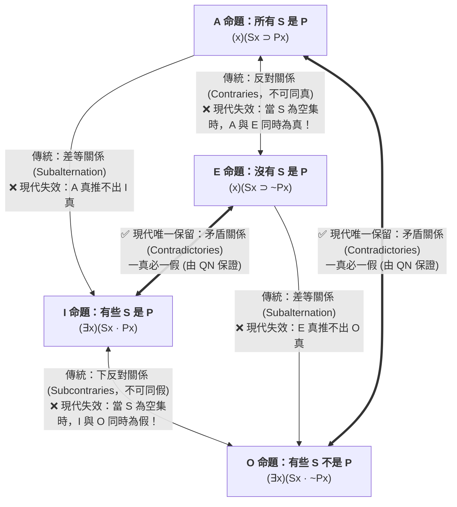

# 量詞、論域與對當方陣 (Quantifiers, Domain, and Square of Opposition)

> **所屬章節**：[[Ch07 述詞邏輯的符號化 (Predicate Logic Symbolization)]]、[[Ch08 述詞邏輯語意學 (Predicate Logic Semantics)]]、[[Ch09 述詞邏輯的證明 (Predicate Logic Proofs)]]
> **對應方法**：[[四條量詞推論規則與五項限制 (Four Quantifier Rules and Five Main Restrictions)]]、[[述詞邏輯解釋與無效性反例法 (Predicate Logic Interpretations and Invalidity Methods)]]
> **對應練習**：[[習題解析三：述詞邏輯與確定描述詞符號化 (Exercises on Predicate Logic Symbolization)]]

述詞邏輯（Predicate Logic, PL）透過引入**個體 (Individuals)**、**述詞 (Predicates)**、**量詞 (Quantifiers)** 與**論域 (Domain)**，成功打開了原子語句的內部黑盒子。本頁統整量詞的作用域與拘束機制、亞里斯多德四大定言命題（A, E, I, O）、范恩圖（Venn Diagrams），以及為什麼現代形式邏輯推翻了傳統對當方陣的大部分關係。

---

## 1. 個體、述詞、量詞與自由/拘束變元

- **個體常元 ($a, b, c \dots t$)** vs. **個體變元 ($u, v, w, x, y, z$)**：
  - 常元指稱論域 $D$ 中特定的單一個體；變元則是可遍歷論域中個體的佔位符。
- **一元述詞 ($Fx$)** vs. **多元關係述詞 ($Rxy, Bxyz$)**：
  - $Fx$ 表個體 $x$ 具有性質 $F$；$Rxy$ 表個體 $x$ 與 $y$ 具有二元關係 $R$（順序不可任意顛倒）。
- **全稱量詞 $(x)$** 與 **存在量詞 $(\exists x)$** 的作用域與變元拘束：
  - 量詞的作用域（Scope）預設為緊隨其後的最短完整公式。
  - **拘束變元 (Bound Variable)**：處於同名量詞作用域內的變元（加上量詞本身裡的那個變元）。
  - **自由變元 (Free Variable)**：不在任何同名量詞作用域內的變元。
  - **範例剖析**：在式子 $(x)Fx \supset Gx$ 中，主要連接詞是 **$\supset$**！前件 $(x)Fx$ 中的 $x$ 是**拘束變元**，但後件 $Gx$ 中的 $x$ 不在 $(x)$ 的作用域內，是**自由變元**！因此整句 $(x)Fx \supset Gx$ 是一個含有自由變元的**開語句 (Open Sentence / Statement Form)**，**沒有真假值**；反之，$(x)(Fx \supset Gx)$ 中的所有 $x$ 皆被 $(x)$ 拘束，才是一個有真假值的完整**語句 (Sentence)**。

---

## 2. 四大定言命題 (A, E, I, O) 與范恩圖 (Venn Diagrams)

設 $Sx$ 代表「$x$ 是 $S$（主詞類）」，$Px$ 代表「$x$ 是 $P$（述詞類）」：

| 命題類型 | 自然語言標準式 | 述詞邏輯標準式 | 量詞否定 (QN) 等值式 | 范恩圖 (Venn Diagram) 集合意義 |
| :---: | :--- | :---: | :---: | :--- |
| **A 命題** (全稱肯定) | 所有 $S$ 都是 $P$ *(All S are P)* | **$(x)(Sx \supset Px)$** | $\sim(\exists x)(Sx \cdot \sim Px)$ | **$S \setminus P = \emptyset$** 將「屬於 $S$ 但不屬於 $P$」的新月形區域**塗黑**（代表該區空無一物） |
| **E 命題** (全稱否定) | 沒有 $S$ 是 $P$ *(No S are P)* | **$(x)(Sx \supset \sim Px)$** | $\sim(\exists x)(Sx \cdot Px)$ | **$S \cap P = \emptyset$** 將「$S$ 與 $P$ 的交集」中央紡錘形區域**塗黑**（代表交集為空） |
| **I 命題** (特稱肯定) | 有些 $S$ 是 $P$ *(Some S are P)* | **$(\exists x)(Sx \cdot Px)$** | $\sim(x)(Sx \supset \sim Px)$ | **$S \cap P \neq \emptyset$** 在「$S$ 與 $P$ 的交集」區域畫上一個 **`X`**（代表至少存在一個個體） |
| **O 命題** (特稱否定) | 有些 $S$ 不是 $P$ *(Some S are not P)* | **$(\exists x)(Sx \cdot \sim Px)$** | $\sim(x)(Sx \supset Px)$ | **$S \setminus P \neq \emptyset$** 在「屬於 $S$ 但不屬於 $P$」的新月形區域畫上一個 **`X`** |

> 💡 **為什麼全稱量詞 $(x)$ 不能配連言 $\cdot$，存在量詞 $(\exists x)$ 不能配條件句 $\supset$？**
> - 若把「所有學生都很用功」寫成 $(x)(Sx \cdot Hx)$，它的意思是「論域中的**每一個東西**（包含你的手機、孔子、十八尖山）都是學生而且都很用功」！
> - 若把「有些學生很用功」寫成 $(\exists x)(Sx \supset Hx)$，它的等值式是 $(\exists x)(\sim Sx \lor Hx)$——只要世界上存在**任何一個不是學生的東西**（例如一顆石頭 $a$ 使 $\sim Sa$ 為真），整句話就自動為真，即便世界上沒有半個用功的學生！

---

## 3. 存在意涵 (Existential Import) 與傳統對當方陣的崩解

- **核心差異：全稱命題是否具有「存在意涵 (Existential Import)」？**
  - **傳統亞里斯多德邏輯**：預設我們談論的主詞類別 $S$ 一定不是空集合（即預設 $(\exists x)Sx$ 為真）。在此預設下，對當方陣的四邊與對角線關係全部成立。
  - **現代一階述詞邏輯（布林—弗雷格詮釋）**：**全稱命題 A 與 E 不具有存在意涵**！
    - 例如科學定律「所有不受外力作用的物體都會保持等速直線運動」或「所有獨角獸都是單角的」：即便宇宙中根本沒有任何不受外力的物體、也沒有任何獨角獸（即對所有 $x$，$Sx$ 皆為 **F**），根據實質條件句 $Sx \supset Px$「前件為假時條件句恆為真」的定義：
    - 當世上沒有任何 $S$（$\sim(\exists x)Sx$）時，**A 命題 $(x)(Sx \supset Px)$ 為真 (T)，且 E 命題 $(x)(Sx \supset \sim Px)$ 也同時為真 (T)**（稱為**空真 Vacuously True**）！
    - 同時，因為世上沒有 $S$，**I 命題 $(\exists x)(Sx \cdot Px)$ 為假 (F)，且 O 命題 $(\exists x)(Sx \cdot \sim Px)$ 也同時為假 (F)**！
- **結論**：在現代述詞邏輯中，傳統對當方陣的四周關係（反對、下反對、差等）全部失效，**唯有對角線上的兩組「矛盾關係 (Contradictories)」（A 與 O 互為否定、E 與 I 互為否定）無條件成立**！這兩條對角線正是 [[Ch09 述詞邏輯的證明 (Predicate Logic Proofs)]] 中**量詞否定規則 (Quantifier Negation, QN)** 的核心。

---

## 4. 量詞推進定理 Q17 與 Q18（橋倒問題與展開式驗證）

當條件句的一端不含變元 $x$（設 $B$ 為不含 $x$ 的常元語句「橋會倒」，$Mx$ 為「$x$ 移動」），量詞放在整個條件句外面 vs. 放在前件裡面，意義截然不同！我們可以用有限論域 $D = \{a, b\}$ 的**展開式 (Expansion)** 立即看穿：

1. **定理 Q17**：**$(x)(Mx \supset B) \ :: \ (\exists x)Mx \supset B$**
   - **日常語意**：「對任何人而言，若他移動，橋就會倒」$\equiv$「**只要有任何一個人（有人）移動，橋就會倒**」。
   - **$D=\{a,b\}$ 展開式驗證**：
     $$(Ma \supset B) \cdot (Mb \supset B) \equiv (\sim Ma \lor B) \cdot (\sim Mb \lor B) \stackrel{\text{Dist}}{\equiv} (\sim Ma \cdot \sim Mb) \lor B \stackrel{\text{DeM}}{\equiv} \sim(Ma \lor Mb) \lor B \stackrel{\text{Impl}}{\equiv} (Ma \lor Mb) \supset B$$
   - 清楚看出：當全稱量詞 $(x)$ 在整個條件句外時，移入前件內部會**翻轉成存在量詞 $(\exists x)$**！
2. **定理 Q18**：**$(\exists x)(Mx \supset B) \ :: \ (x)Mx \supset B$**
   - **日常語意**：**「若所有人都移動，橋才會倒」**。
   - **$D=\{a,b\}$ 展開式驗證**：
     $$(Ma \cdot Mb) \supset B \equiv \sim(Ma \cdot Mb) \lor B \equiv (\sim Ma \lor \sim Mb) \lor B \equiv (\sim Ma \lor B) \lor (\sim Mb \lor B) \equiv (Ma \supset B) \lor (Mb \supset B)$$
   - *注意*：若後件含 $x$ 而前件不含 $x$（如 $B \supset (x)Mx$），則量詞移入後件時**不會翻轉**：$(x)(B \supset Mx) :: B \supset (x)Mx$；$(\exists x)(B \supset Mx) :: B \supset (\exists x)Mx$（完整 55 條量詞定理請參閱 [[述詞邏輯55條核心定理與量詞推論架構 (55 Theorems of Predicate Logic)]]）。

---

## 5. 專題補充：自然語言中的「部分否定 (Partial Negation)」、「全部否定 (Total Negation)」與「雙重否定 (Double Negation)」翻譯鐵律

> **對應原始補充講義**：`raw/Supp_Ch07_補充一_部份否定與全部否定.docx`、`raw/Supp_Ch07_補充二_部分否定全部否定和雙重否定的翻譯.docx`

在英語與漢語的語法差異中，帶有否定詞的量化句型是邏輯符號化的最大陷阱區：

### (1) 部分否定 (Partial Negation) —— 否定號在全稱/連言括弧「外」：$\sim(x)(Fx \supset Gx)$ 或 $\sim(A \cdot B)$
當 `not` 出現在含有表示「全部肯定」的不定代詞（`all`, `every`, `everyone`, `everybody`, `everything`, `both`）或總括性副詞（`always`, `altogether`, `completely`, `entirely`, `wholly`, `everywhere`, `necessarily`, `generally`）的句子中，**不論 `not` 在該詞之前還是之後，一律表示「部分否定」（並非所有……都 / 並非兩者皆）**！

| 範圍 | 英文部分否定句型範例 | 中文精準語意 | 邏輯符號化形式 |
| :--- | :--- | :--- | :--- |
| **兩者 (Two)** | • *I do not know **both** of them.* • ***Both** of the brothers are **not** dead.* • ***Both** Alex and Lewis are **not** ill.* | • 他們兩位我**並不是都**認識。 • **並非**兄弟兩人都死了。 • **並非** Alex 和 Lewis 都生病了。 | **$\sim(A \cdot B)$** *(等值於 $\sim A \lor \sim B$)* |
| **三者以上 (All / Every)** | • ***Not all** birds can fly.* / ***All** birds **can't** fly.* • ***All** that glitters is **not** gold.* (Ex 7-10 第 5 題) • *If **all** elephants are **not** protected, all elephants are doomed.* (Ex 7-11) • ***Not everyone** can be a hero.* | • **並非所有**的鳥都能飛（切勿誤譯為所有的鳥都不能飛！）。 • 發光的**不一定全是**金子。 • 若**並非所有**大象都受保護，所有大象都會滅絕。 • **並非每個人**都能當英雄。 | **$\sim(x)(Fx \supset Gx)$** *(O 命題，由 QN 等值於 $(\exists x)(Fx \cdot \sim Gx)$)* |
| **總括副詞** | • *He was **not altogether / completely / wholly** satisfied.* • *Crows are **not always** black.* | • 他**並不全然**滿意。 • 烏鴉**未必總是**黑色的。 | **$\sim(x)(Tx \supset Bx)$** |

> 💡 **講義 Ex 7-11 經典辨析：為什麼 *"If all elephants are not protected, all elephants are doomed"* 的前件必須譯為部分否定 $\sim(x)(Ex \supset Px)$ 而非全部否定 $(x)(Ex \supset \sim Px)$？**
> 1. 英文 *"All elephants are not protected"* 在文法上等同於 *"Not all elephants are protected"*（部分否定：並非所有大象都受保護，即有些大象沒受保護 $(\exists x)(Ex \cdot \sim Px)$）。
> 2. 若誤譯為全部否定 $(x)(Ex \supset \sim Px)$（「沒有任何一隻大象受到保護」），因為現實中至少有一些大象在保育區受保護，前件 $(x)(Ex \supset \sim Px)$ 為**假 (`F`)**，會導致整句條件句變成毫無實質意義的「空真 / 廢話真理 (Trivially True)」！唯有譯為 **$\sim(x)(Ex \supset Px) \supset (x)(Ex \supset Dx)$**，才符合保育者強調「只要有部分大象沒受保護，全體大象就會面臨滅絕危機」的真實語意！

### (2) 全部否定 (Total Negation) —— 否定號在量詞「內」後件：$(x)(Fx \supset \sim Gx)$ 或 $\sim A \cdot \sim B$
當要表達「全部皆非 / 一個也沒有」時，英文會使用明確的絕對否定詞（`neither`, `not...either`, `none`, `no one`, `nobody`, `nothing`, `never`, `nowhere`, `not...at all`, `not...in the least / slightest`）：

| 範圍 | 英文全部否定句型範例 | 中文精準語意 | 邏輯符號化形式 |
| :--- | :--- | :--- | :--- |
| **兩者 (Neither)** | • *I do **not** know **either** of them.* = *I know **neither** of them.* • ***Neither** of the brothers is dead.* • ***Either** of us **isn't** a doctor.* = ***Neither** of us is a doctor.* | • 他們兩位我**都不**認識。 • 兄弟兩人**都沒**死。 • 我們兩個**都不是**醫生。 | **$\sim A \cdot \sim B$** *(等值於 $\sim(A \lor B)$)* |
| **三者以上 (None / No)** | • ***None** of my brothers teach English.* • ***No one / Nobody** can be a hero.* • *Crows are **never** black.* • *All his haste was **of no use**.* | • 我的兄弟**都不**教英文。 • **沒有任何人**能當英雄。 • 烏鴉**絕不是**黑色的。 • 他所有的匆忙**全無用處**。 | **$(x)(Fx \supset \sim Gx)$** *(E 命題，由 QN 等值於 $\sim(\exists x)(Fx \cdot Gx)$)* |
| **程度副詞** | • *He was **not** satisfied **at all / in the least / a bit**.* | • 他**完全不**滿意。 | **$\sim S$** |

### (3) 雙重否定 (Double Negation) —— 負負得正轉化為全稱肯定句
在自然語言中，同一個單句出現兩次否定詞（雙重否定），在邏輯真值上等同於**肯定句**（由 **DN** 或 **QN** $\sim(\exists x)(Fx \cdot \sim Gx) \ :: \ (x)(Fx \supset Gx)$）：
1. **否定代詞 (`nothing / none / nobody`) + 否定詞綴/否定動詞**：
   - *Nothing is impossible / changeless.*（無一事不可能／無物不變 $\implies$ 萬事皆可能／萬物皆變）：$\sim(\exists x)\sim Px \ :: \ (x)Px$。
   - *Nobody wasn't invited.*（沒有人沒受邀 $\implies$ 每個人都受邀了）：$\sim(\exists x)(Px \cdot \sim Ix) \ :: \ (x)(Px \supset Ix)$。
2. **否定詞 (`not / never / no`) + `without` 或關係代詞 `but`（意為 `who...not`）**：
   - *The cleverest housewife **can't** cook a meal **without** rice.*（巧婦難為無米之炊 = 只有有米，巧婦才能做飯）：$C \supset R$。
   - *There is **no** man **but** has his faults.*（沒有一個人沒有過錯 = 人皆有過）：$\sim(\exists x)(Mx \cdot \sim Fx) \ :: \ (x)(Mx \supset Fx)$。
   - *It **never** rains **but** it pours.*（不雨則已，一雨傾盆 = 只要下雨就必下大雨）：$(x)[(Tx \cdot Rx) \supset Px]$。
3. **`no / not` + 負面意義詞彙或半否定詞 (`little`)**：
   - *not meaningless*（並非無意義 = 有意義）、*no little interest*（不小的興趣 = 極大的興趣）。

---

## 5. 相關概念與方法連結

- **下一個概念**：加入等同號 `=` 後如何表達「至少兩個、至多一個、恰好一個」與確定描述詞？ $\implies$ [[等同與確定描述詞理論 (Identity and Theory of Descriptions)]]
- **語意反例方法**：如何用展開式證明述詞邏輯論證無效？ $\implies$ [[述詞邏輯解釋與無效性反例法 (Predicate Logic Interpretations and Invalidity Methods)]]
- **語法證明方法**：如何用 UI, EI, UG, EG 與 QN 進行形式推導？ $\implies$ [[四條量詞推論規則與五項限制 (Four Quantifier Rules and Five Main Restrictions)]]
- **實戰演練**：[[習題解析三：述詞邏輯與確定描述詞符號化 (Exercises on Predicate Logic Symbolization)]]
