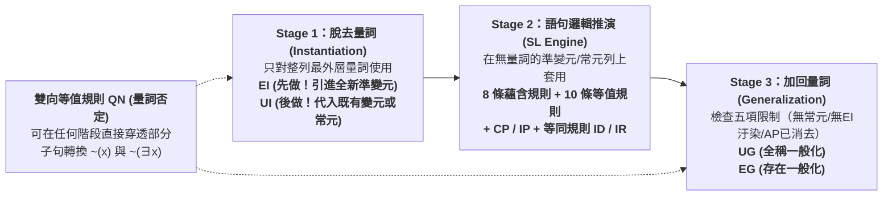

# 四條量詞推論規則與五項限制 (Four Quantifier Rules and Five Main Restrictions)

> **所屬章節**：[[Ch09 述詞邏輯的證明 (Predicate Logic Proofs)]]、[[Ch11 等同與確定描述詞 (Identity and Definite Descriptions)]]
> **理論基礎**：[[量詞、論域與對當方陣 (Quantifiers, Domain, and Square of Opposition)]]、[[等同與確定描述詞理論 (Identity and Theory of Descriptions)]]
> **前置規則**：[[八條單向蘊含推論規則 (Eight Implicational Rules of Inference)]]、[[十條雙向等值置換規則 (Ten Equivalence Rules of Replacement)]]、[[條件證法與間接證法 (Conditional and Indirect Proof - CP and IP)]]
> **對應練習**：[[習題解析四：述詞邏輯無效性反例與量詞證明 (Exercises on Predicate Logic Invalidity and Proofs)]]

述詞邏輯（PL）的自然演繹系統是在語句邏輯（SL）的 **18 條規則 + CP/IP** 之上，新增 **4 條單向量詞規則 (UI, EI, UG, EG)**、**1 組雙向量詞否定規則 (QN)**，以及處理等同關係的 **2 條等同規則 (ID, IR)**。本頁詳解這套推論引擎的操作規範，特別是決定證明生死成敗的**五項主要限制 (The Five Main Restrictions)**。

---

## 1. 述詞邏輯證明的三階段引擎架構



> ⚠️ **絕對鐵律**：
> 1. **語句邏輯的 18 條規則絕對不能直接套用在量詞管轄範圍內部**！例如從 `1. (x)(Fx ⊃ Gx)` 與 `2. (x)Fx` **絕對不能**直接用 MP 得 `(x)Gx`！必須先分別用 **UI** 得 `3. Fx ⊃ Gx` 與 `4. Fx`，再用 **MP** 得 `5. Gx`，最後用 **UG** 得 `6. (x)Gx`。
> 2. **UI, EI, UG, EG 四條量詞規則全部都是「單向蘊含規則」，只能套用在「整個列 (Whole Lines)」上**！只有當量詞是該列的**主要運算元**（管轄整列）時，才能用 UI/EI 脫去，或用 UG/EG 加上！
>    - 🚫 錯誤示範：從 `1. (x)Fx ⊃ Ga` 用 UI 得 `2. Fx ⊃ Ga` ❌（因為第 1 列的主要連接詞是 $\supset$，$(x)$ 只管轄前件，不能對局部子句做 UI！）。

---

## 2. 四條單向量詞規則與五項主要限制對照總表

| 規則 | 推論圖式 | 針對「個體常元 ($a,b,c$)」的限制 | 針對「準變元 ($x,y,z$)」的限制 | 附加語法精確限制 (Ch.11) |
| :--- | :---: | :--- | :--- | :--- |
| **UI**<br>(全稱引例) | $\frac{(u)(\dots u \dots)}{\therefore (\dots w \dots)}$ | ✅ **允許**代入任何個體常元 | ✅ **允許**代入任何自由準變元（無論新舊） | 代入的 $w$ 必須一致取代所有自由的 $u$，且**不可被式內其他量詞意外拘束** |
| **EI**<br>(存在引例) | $\frac{(\exists u)(\dots u \dots)}{\therefore (\dots w \dots)}$ | 🚫 **【EI 限制 1】**<br>**絕對禁止**引進個體常元！ | 🚫 **【EI 限制 2】**<br>引進的準變元 $w$ **絕對不能在先前證明列中自由出現過**（必須是全新自由變元！） | 代入的 $w$ 必須一致取代所有自由的 $u$，且不可被式內其他量詞意外拘束 |
| **UG**<br>(全稱一般化) | $\frac{(\dots u \dots)}{\therefore (w)(\dots w \dots)}$ | 🚫 **【UG 限制 1】**<br>**絕對禁止**對個體常元做 UG！ | 🚫 **【UG 限制 2】**<br>**絕對禁止**對「在任何 EI 列中自由出現過的準變元」做 UG！（含直接引進與同列沾染下毒）<br>🚫 **【UG 限制 3】**<br>在**未消去的 AP 封閉線內**，禁止對該 AP 中自由出現的準變元做 UG！（消去 AP 後即解毒可做 UG） | 必須將該列中**所有自由出現的 $u$ 全部拘束**為 $(w)$（不可只拘束部分）；且式內原本不可已有自由的 $w$ 或被內部 $(w)$ 意外拘束 |
| **EG**<br>(存在一般化) | $\frac{(\dots u \dots)}{\therefore (\exists w)(\dots w \dots)}$ | ✅ **允許**對個體常元做 EG（可只取代部分出現的常元） | ✅ **允許**對任何自由準變元做 EG（即使來自 EI 或 AP 亦可做 EG！） | 可取代**一或多個** $u$ 為 $(\exists w)$；但式內**原本不可已有自由的 $w$**（不可從 $Lxy$ 用 EG 得 $(\exists x)Lxx$），且不可被內部 $(\exists w)$ 意外拘束 |

---

## 3. 五項主要限制的深度診斷與「下毒/解毒」機制

### (1) 為什麼必須「先做 EI，再做 UI」？（應對 EI 限制 2）
- 假設前提有 `1. (x)(Fx ⊃ Gx)` 與 `2. (∃x)Fx`。
- ❌ **錯誤順序（先 UI 後 EI）**：若先對第 1 列做 UI 得 `3. Fx ⊃ Gx`，此時變元 `$x$` 已經在第 3 列自由出現了！接下來對第 2 列 `(∃x)Fx` 做 EI 時，根據 **【EI 限制 2】**，你**不能再使用 `$x$`**，只能被迫換成另一個新變元 `4. Fy`！結果 `Fx ⊃ Gx` 跟 `Fy` 變元不同，完全無法用 MP！
- ✅ **正確順序（先 EI 後 UI）**：
  1. 先對第 2 列 `(∃x)Fx` 做 **EI** 得 `3. Fx`（此時 `$x$` 是全新變元，完全合法！）。
  2. 再對第 1 列 `(x)(Fx ⊃ Gx)` 做 **UI** 得 `4. Fx ⊃ Gx`（UI 沒有新變元限制，可以自由選用剛剛已出現的 `$x$`！）。
  3. 對 3, 4 用 **MP** 得 `5. Gx`，再用 **EG** 得 `6. (∃x)Gx`！

### (2) 什麼是【UG 限制 2】的「EI 同列沾染下毒 (Tainting)」？
- 多數人知道「由 EI 直接脫掉存在量詞引進的變元 $y$ 不能做 UG」，但最常在多量詞題目中忽略：**只要一個變元 $x$ 在任何一個 EI 步驟所得出的那一列中「自由出現」，即便 $x$ 當初是由 UI 引進的，它也在該 EI 列中被「下毒汙染」了，永遠不能再做 UG**！
- **經典案例診斷**（為何不能從「每個人都愛某人 $(x)(\exists y)Lxy$」推得「有某人被所有人愛 $(\exists y)(x)Lxy$」？）：
  ```text
  1. (x)(∃y)Lxy          p
  2. (∃y)Lxy             1 UI (此時 x 由 UI 引進，尚未中毒)
  3. Lxy                 2 EI (脫去 (∃y) 引進新變元 y —— 注意！x 在這條 EI 列中自由出現了，x 被 y 下毒汙染！)
  4. (x)Lxy              3 UG ❌ 【嚴重違規！違反 UG 限制 2：x 曾於第 3 列 (EI 列) 中自由出現！】
  5. (∃y)(x)Lxy          4 EG
  ```
  - **哲學直覺**：在第 3 列 $Lxy$ 中，被愛的對象 $y$ 是**依賴於 $x$ 的選擇而決定的**（張三愛張三的太太，李四愛李四的太太），因此一旦與 $y$ 綁在同一條 EI 列，$x$ 就喪失了彼此獨立的普遍任意性！

### (3) 什麼是【UG 限制 3】的「AP 封閉線內禁用 UG，但消去 AP 後解毒」？
- 當我們為了證明全稱條件句 **$(x)(Fx \supset Gx)$** 而沒有好用的全稱前提時，可以結合 **CP + UG**：
  ```text
  1. (x)[Fx ⊃ (Gx · Hx)]   p
     | 2. Fx               AP (在封閉線內引入含有自由準變元 x 的假設前提)
     | 3. Fx ⊃ (Gx · Hx)   1 UI
     | 4. Gx · Hx          2, 3 MP
     | 5. Gx               4 Simp (注意：在封閉線內部，絕對不能對 x 做 UG！)
  6. Fx ⊃ Gx               2–5 CP (關閉封閉線，消去 AP！此時 x 已成功「解毒」不再依賴未消去 AP)
  7. (x)(Fx ⊃ Gx)          6 UG   ✅ (在封閉線外，合法對 x 做 UG！)
  ```

---

## 4. 量詞否定規則 (QN) 與等同規則 (ID, IR)

### (1) 雙向等值置換規則：量詞否定 (Quantifier Negation, QN)
- **特權**：與 SL 的 10 條等值規則一樣，**QN 是雙向等值 (`::`)，可以直接套用在語句內部的部分子句上**！
- **四種標準型（口訣：量詞互換 $(u) \leftrightarrow (\exists u)$，量詞前後兩側否定號 $\sim$ 有就拿掉、無就加上）**：
  1. $(u)\Phi u \ :: \ \sim(\exists u)\sim\Phi u$
  2. $(\exists u)\Phi u \ :: \ \sim(u)\sim\Phi u$
  3. $(u)\sim\Phi u \ :: \ \sim(\exists u)\Phi u$
  4. $(\exists u)\sim\Phi u \ :: \ \sim(u)\Phi u$
- **實戰時機**：當前提或結論開頭帶有 **$\sim(x)$** 或 **$\sim(\exists x)$** 時，**不能**直接做 UI 或 EI（因為主要連接詞是 $\sim$ 而非量詞！），必須**先用 QN 把外面的 $\sim$ 移進量詞內部**，讓量詞成為整列最外層的主要運算元後，才能做 UI 或 EI！

### (2) 兩條等同推論規則：ID 與 IR（Ch. 11 / 13）
1. **等同規則 (Rule of Identity, ID)**：
   $$\frac{(\dots u \dots), \quad u = w \text{ (或 } w = u \text{)}}{\therefore (\dots w \dots)}$$
   - 允許將一列中自由出現的一或多個 $u$ 替換為與其等同的 $w$（即使等式寫成 $w = u$ 亦可直接替換，無須先證明對稱性）。
2. **等同反身性規則 (Identity Reflexivity, IR)**：
   $$\vdash (x)(x = x) \quad \text{或直接寫出} \quad u = u$$
   - 零前提規則，可在任何步驟直接寫出 $(x)(x = x)$。

---

## 5. 相關概念與方法連結

- **三大限制總整理**：[[邏輯推論中的三大核心限制與防呆機制比較 (Comparison of Core Restrictions in Formal Proofs)]]
- **當無法證出時如何找反例？** $\implies$ [[述詞邏輯解釋與無效性反例法 (Predicate Logic Interpretations and Invalidity Methods)]]
- **實戰演練**：[[習題解析四：述詞邏輯無效性反例與量詞證明 (Exercises on Predicate Logic Invalidity and Proofs)]]
