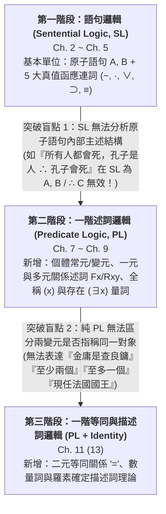

# 語句邏輯與述詞邏輯的演進與比較 (Evolution from Sentential to Predicate and Identity Logic)

> **跨章節綜整範圍**：[[Ch02 語句邏輯的符號化 (Symbolizing in Sentential Logic)]] $\rightarrow$ [[Ch07 述詞邏輯的符號化 (Predicate Logic Symbolization)]] $\rightarrow$ [[Ch11 等同與確定描述詞 (Identity and Definite Descriptions)]]
> **關聯核心概念**：[[真值函應與邏輯連詞 (Truth-Functions and Logical Connectives)]]、[[量詞、論域與對當方陣 (Quantifiers, Domain, and Square of Opposition)]]、[[等同與確定描述詞理論 (Identity and Theory of Descriptions)]]、[[後設邏輯：健全性與完備性 (Metalogic - Soundness and Completeness)]]

在本知識庫的九個章節中，形式邏輯系統經歷了兩次重大的**表達力躍遷 (Leaps in Expressive Power)**：從**語句邏輯 (Sentential Logic, SL)** 演進到**一階述詞邏輯 (Predicate Logic, PL)**，再演進到**一階等同與描述詞邏輯 (Predicate Logic with Identity, PL+=)**。每次擴充都是為了克服前一個系統無法分析某些有效推論的盲點，但同時也伴隨著語意複雜度與可判定性（Decidability）的深刻變化。

---

## 1. 三階段邏輯系統演進動機與能力邊界

---

## 2. 三大邏輯系統的全方位比較矩陣

| 比較維度 | 語句邏輯 (Sentential Logic, SL) (Ch. 2 ~ Ch. 5) | 一階述詞邏輯 (Predicate Logic, PL) (Ch. 7 ~ Ch. 9) | 一階等同述詞邏輯 (PL with Identity) (Ch. 11 / 13) |
| :--- | :--- | :--- | :--- |
| **最小分析顆粒度** | **完整的原子陳述句** ($A, B, C$) | **個體** ($a, b, x, y$) 與**性質/關係** ($Fx, Rxy$) | 個體、性質/關係 + **個體間的同一性 (`=`)** |
| **核心邏輯算子** | 5 大真值函應連詞： $\sim, \ \cdot, \ \lor, \ \supset, \ \equiv$ | SL 5 大連詞 + 2 大量詞： 全稱 **$(x)$**、存在 **$(\exists x)$** | SL 連詞 + 2 大量詞 + 等同號 **`=`** ($\neq$) |
| **是否服從真值函應原則？** | **100% 真值函應** （複合句真值完全由原子句真值決定） | **非真值函應** （量限句 $(x)Fx$ 的真值取決於論域 $D$ 中所有個體的解釋） | **非真值函應** |
| **語意學可能狀態數** | **有限個**：含 $n$ 個原子句共有 **$2^n$ 列**真值賦值 | **無限多個**：論域 $D$ 可為任意大小或無限集，解釋有無限多種 | **無限多個**（且 `=` 的解釋固定為論域上的嚴格同一關係） |
| **證明「無效 / 一致」的方法** | [[真值表與簡短真值表法 (Truth Table and Short Truth Table Method)]]（找一列反例賦值） | [[述詞邏輯解釋與無效性反例法 (Predicate Logic Interpretations and Invalidity Methods)]]（日常反例、正整數反例、有限模型展開式） | 滿足等同公理的反例解釋或有限模型展開式 |
| **自然演繹語法證明規則** | - [[八條單向蘊含推論規則 (Eight Implicational Rules of Inference)]] - [[十條雙向等值置換規則 (Ten Equivalence Rules of Replacement)]] - [[條件證法與間接證法 (Conditional and Indirect Proof - CP and IP)]] | SL 全部規則 + - 4 條單向量詞規則 (**UI, EI, UG, EG**) 與**五項限制** - 雙向量詞否定規則 (**QN**) | PL 全部規則 + - **等同規則 (ID)** - **等同反身性規則 (IR)** |
| **系統健全性與完備性** | ✅ **健全且完備** （$\Gamma \vdash C \iff \Gamma \models C$） | ✅ **健全且完備** （哥德爾完備性定理，1929） | ✅ **健全且完備** |
| **機械可判定性 (Decidability)** | ✅ **完全可判定 (Decidable)** （真值表法必在有限步內給出答案） | ⚠️ **一元述詞邏輯可判定**（檢驗至多 $2^n$ 個體）； 🚫 **含多元關係的一階述詞邏輯不可判定 (Undecidable)**（邱奇定理，1936） | 🚫 **不可判定 (Undecidable)** |

---

## 3. 跨系統的結構同構性 (Structural Isomorphisms)

儘管從 SL 到 PL 再到 PL+= 表達力大幅提升，但它們底層貫穿著驚人的**結構同構性**：

1. **全稱量詞 $(x)$ 是無限版的連言 `$\cdot$`；存在量詞 $(\exists x)$ 是無限版的選言 `$\lor$`**
   - 在有限論域 $D = \{a, b, c\}$ 中：
     - $(x)Fx$ 展開為 **$Fa \cdot Fb \cdot Fc$**
     - $(\exists x)Fx$ 展開為 **$Fa \lor Fb \lor Fc$**
   - 這直接解釋了為什麼：
     - **全稱引例 (UI)** 就像是對 $(Fa \cdot Fb \cdot Fc)$ 做 **簡化律 (Simp)**（從連言中任意取出一個 $Fa$）！
     - **存在一般化 (EG)** 就像是對 $Fa$ 做 **添加律 (Add)**（從單一 $Fa$ 弱化為 $Fa \lor Fb \lor Fc$）！
     - **量詞否定 (QN)**（如 $\sim(x)Fx :: (\exists x)\sim Fx$ 與 $\sim(\exists x)Fx :: (x)\sim Fx$）完全就是無限版的 **狄摩根定理 (DeM)**（$\sim(Fa \cdot Fb) :: \sim Fa \lor \sim Fb$ 與 $\sim(Fa \lor Fb) :: \sim Fa \cdot \sim Fb$）！
2. **「只有 (Only)」與「除非 (Unless)」在 SL 與 PL 中的完全同構**
   - 在 SL 中：`A only if B` $\implies A \supset B$；`A unless B` $\implies \sim B \supset A$。
   - 在 PL 中：`Only A are B`（只有 A 是 B = 若是 B 則必是 A）$\implies (x)(Bx \supset Ax)$；`No B unless A` $\implies (x)(\sim Ax \supset \sim Bx) \equiv (x)(Bx \supset Ax)$。
   - 在等同邏輯中：`Only George passed` $\implies Pg \cdot (x)[Px \supset (x = g)]$！

---

## 4. 延伸探索連結

- **語法與語意如何雙軌對稱？** $\implies$ [[語法學與語意學的雙軌對稱架構 (Syntactic vs Semantic Dual Architecture in Logic)]]
- **三大推論限制背後的統一防呆哲學** $\implies$ [[邏輯推論中的三大核心限制與防呆機制比較 (Comparison of Core Restrictions in Formal Proofs)]]
