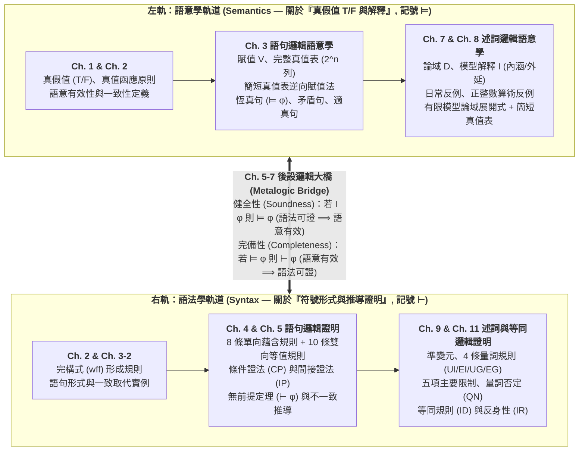

# 語法學與語意學的雙軌對稱架構 (Syntactic vs Semantic Dual Architecture in Logic)

> **跨章節綜整範圍**：語意學線（[[Ch01 邏輯導論 (Introduction to Logic)]] $\rightarrow$ [[Ch02 語句邏輯的符號化 (Symbolizing in Sentential Logic)]] $\rightarrow$ [[Ch03 真值表 (Truth Tables)]] $\rightarrow$ [[Ch07 述詞邏輯的符號化 (Predicate Logic Symbolization)]] $\rightarrow$ [[Ch08 述詞邏輯語意學 (Predicate Logic Semantics)]]） vs. 語法學線（[[Ch04 自然演繹法證明 (Natural Deduction Proofs)]] $\rightarrow$ [[Ch05 條件證法與間接證法 (Conditional and Indirect Proofs)]] $\rightarrow$ [[Ch09 述詞邏輯的證明 (Predicate Logic Proofs)]] $\rightarrow$ [[Ch11 等同與確定描述詞 (Identity and Definite Descriptions)]]）
> **核心後設橋樑**：[[後設邏輯：健全性與完備性 (Metalogic - Soundness and Completeness)]]

初學形式邏輯時，往往覺得各章節零散：一會兒畫真值表、一會兒背 18 條規則、一會兒找正整數反例、一會兒又要注意 EI/UG 五項限制。然而，若從高階視角俯瞰整本教材，所有章節其實嚴格排列在**「語意學 (Semantics, $\models$)」**與**「語法學 (Syntax, $\vdash$)」**這兩條平行對稱的軌道上，並由**健全性 (Soundness)** 與**完備性 (Completeness)** 這座後設邏輯大橋將兩軌完美縫合。

---

## 1. 雙軌對稱全景架構圖

---

## 2. 為什麼我們需要兩條軌道？（單一軌道的局限與互補）

在實際解題與邏輯研究中，語意學軌道與語法學軌道具有**互補分工**的關鍵關係：

| 任務目標 | 在語句邏輯 (SL) 中誰最擅長？ | 在一階述詞邏輯 (PL) 中誰最擅長（甚至唯一可行）？ | 為什麼？ |
| :--- | :--- | :--- | :--- |
| **1. 證明論證「無效 (Invalid)」** 或**語句集「一致 (Consistent)」** | **語意學軌道** （[[真值表與簡短真值表法 (Truth Table and Short Truth Table Method)]]） | **語意學軌道（唯一方法！）** （[[述詞邏輯解釋與無效性反例法 (Predicate Logic Interpretations and Invalidity Methods)]]） | **自然演繹法（語法軌道）完全無法證明一個論證無效**！（你證不出來，可能是它真的無效，也可能是你還沒想出證明步驟）。要證無效，**只能走語意軌道構造一個使前提皆 T、結論為 F 的反例賦值或反例解釋**！ |
| **2. 證明論證「有效 (Valid)」** 或**語句「恆真 / 定理」** 或**語句集「不一致 (Inconsistent)」** | - 變元少 ($n \le 3$)：真值表或簡短真值表皆可 - 變元多 ($n \ge 4$)：**語法學軌道（自然演繹證明）**遠比 $2^n$ 真值表簡潔且直覺 | **語法學軌道（唯一通用方法！）** （[[四條量詞推論規則與五項限制 (Four Quantifier Rules and Five Main Restrictions)]]） | 在述詞邏輯中，由於可能的論域與解釋有**無限多種**，你**永遠不可能用窮舉反例解釋的方法來證明一個 PL 論證有效**！要證明 PL 論證有效，必須走**語法學軌道**，用 UI/EI/UG/EG 與 SL 規則推導出結論！ |

---

## 3. 語意學與語法學的七大核心概念一對一映射表

| 編號 | 語意學概念 (Semantic Concept) | 語法學對映概念 (Syntactic Counterpart) | 連結兩者的後設原理 |
| :---: | :--- | :--- | :--- |
| 1 | **真值條件與賦值 / 解釋** (Truth-Conditions & Valuation $V$ / Interpretation $I$) | **完構式形成規則與取代實例** (Formation Rules for wff & Substitution Instance) | 語法規定哪些字串合法，語意賦予合法字串真假值 |
| 2 | **恆真句 / 邏輯真理** (Tautology / Logical Truth, $\models \phi$) | **定理** (Theorem / Zero-Premise Deduction, $\vdash \phi$) | $\models \phi \iff \vdash \phi$ （由健全性與完備性保證） |
| 3 | **語意有效論證** (Semantically Valid Argument, $\Gamma \models C$) | **語法可證論證 / 自然演繹證明** (Syntactically Derivable Proof, $\Gamma \vdash C$) | $\Gamma \models C \iff \Gamma \vdash C$ （由健全性與完備性保證） |
| 4 | **語意邏輯蘊涵** ($X \supset Y$ 為恆真句) | **8 條單向蘊含規則 + 4 條量詞規則** (MP, MT, DS, HS, Simp, Conj, Add, CD + UI, EI, UG, EG) | 每一條單向推論規則都是保真的（Truth-Preserving） |
| 5 | **語意邏輯等值** ($X \equiv Y$ 為恆真句，每列真值相同) | **10 條雙向等值置換規則 + QN** (DN, DeM, Comm, Assoc, Dist, Contra, Impl, Exp, Taut, Equiv + QN) | 因為語意上雙向同真同假，故語法上允許在**部分子句**直接雙向置換 (`::`) |
| 6 | **相應條件句為恆真句** ($(P_1 \cdot \dots \cdot P_n) \supset C$ 恆真) | **條件證法 (Conditional Proof, CP)** (假設 $P$ [AP] 推得 $C$，消去 AP 得 $P \supset C$) | 演繹定理 (Deduction Theorem)：$\Gamma \cup \{P\} \vdash C \iff \Gamma \vdash P \supset C$ |
| 7 | **反例集語意不一致** ($\{P_1 \dots P_n, \sim C\}$ 無任何同真列/解釋) | **間接證法 / 歸謬證法 (Indirect Proof, IP)** (假設 $\sim C$ [AP] 推導出顯性矛盾句 $q \cdot \sim q$) | 歸謬定理：$\Gamma \cup \{\sim C\} \vdash q \cdot \sim q \iff \Gamma \vdash C$ |

---

## 4. 延伸探索連結

- **深入了解後設邏輯定理**：[[後設邏輯：健全性與完備性 (Metalogic - Soundness and Completeness)]]
- **三大邏輯系統的演進**：[[語句邏輯與述詞邏輯的演進與比較 (Evolution from Sentential to Predicate and Identity Logic)]]
- **語法軌道為何需要嚴格限制以確保不越界（維持健全性）？** $\implies$ [[邏輯推論中的三大核心限制與防呆機制比較 (Comparison of Core Restrictions in Formal Proofs)]]
