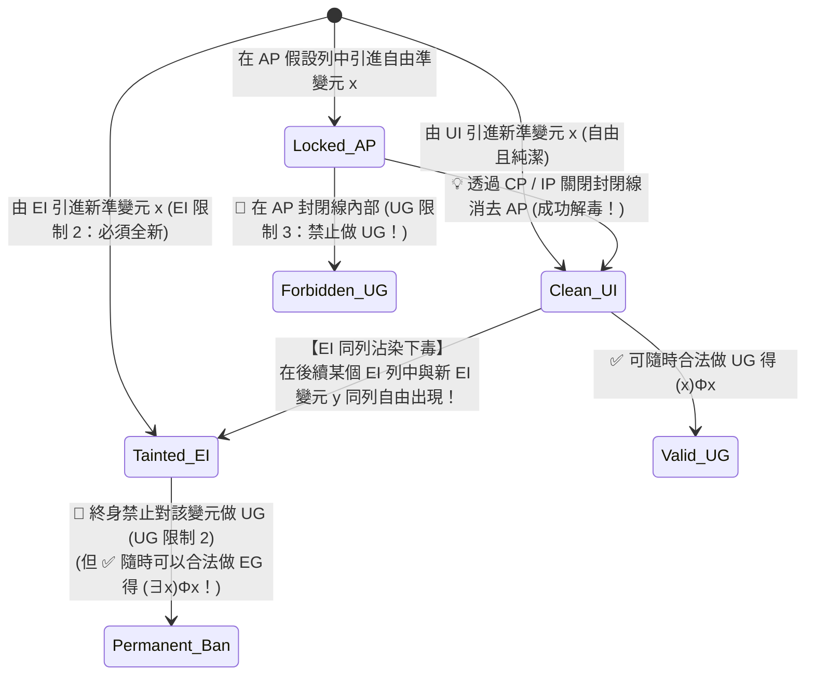

# 邏輯推論中的三大核心限制與防呆機制比較 (Comparison of Core Restrictions in Formal Proofs)

> **跨章節綜整範圍**：[[Ch04 自然演繹法證明 (Natural Deduction Proofs)]] $\rightarrow$ [[Ch05 條件證法與間接證法 (Conditional and Indirect Proofs)]] $\rightarrow$ [[Ch09 述詞邏輯的證明 (Predicate Logic Proofs)]]
> **關聯核心方法**：[[八條單向蘊含推論規則 (Eight Implicational Rules of Inference)]]、[[條件證法與間接證法 (Conditional and Indirect Proof - CP and IP)]]、[[四條量詞推論規則與五項限制 (Four Quantifier Rules and Five Main Restrictions)]]
> **對應練習**：[[習題解析二：語句邏輯自然演繹法、CP與IP證明 (Exercises on Sentential Logic Proofs)]]、[[習題解析四：述詞邏輯無效性反例與量詞證明 (Exercises on Predicate Logic Invalidity and Proofs)]]

為什麼在自然演繹法（Natural Deduction）中，邏輯學家要設下這麼多看似繁瑣的「限制 (Restrictions)」？
從 [[後設邏輯：健全性與完備性 (Metalogic - Soundness and Completeness)]] 的角度來看：**所有的語法限制，都是為了捍衛邏輯系統的「健全性 (Soundness)」**！只要違反以下三大限制家族中的任何一條，推論系統就會立刻失守，從真前提推導出假結論（把無效論證誤證為有效）。本頁將散落在 Ch. 4、Ch. 5 與 Ch. 9 的所有限制進行系統化對比與統一剖析。

---

## 1. 三大核心限制家族總覽對照表

| 限制家族 | 所屬章節與規則 | 核心禁令內容 | 為什麼要有這條限制？（若違反會推導出什麼荒謬反例？） | 合法破解 / 繞道技巧 |
| :--- | :--- | :--- | :--- | :--- |
| **第一家族： 整列限制** (Whole-Line Restriction) | **Ch. 4 & Ch. 9** 8 條單向蘊含規則 (MP, MT, DS, HS, Simp, Conj, Add, CD) + 4 條單向量詞規則 (UI, EI, UG, EG) | **只能套用在整個列上（針對整列的主要連接詞/最外層量詞）**，絕對禁止套用在括弧內或條件句內部的**部分子句**上！ | 單向規則只保證「整句為真時結論為真」，但子句處於條件句前件或否定號內時並未被斷言為真！ 🚫 **違規反例**：從 `(A · B) ⊃ C` 對前件局部用 Simp 得 `A ⊃ C`（若 A=T, B=F, C=F，前提為 T 但結論為 F！）；或從 `(x)Fx ⊃ Ga` 對前件局部用 UI 得 `Fx ⊃ Ga`。 | 改用 **10 條雙向等值置換規則 (`::`)** 或 **量詞否定 (QN)**（如用 **Dist** 把 $A \lor (B \cdot C)$ 轉為 $(A \lor B) \cdot (A \lor C)$ 後，主要連接詞變成 $\cdot$，即可合法用 Simp！） |
| **第二家族： 封閉線作用域限制** (Scope-Line / AP Discharge Restriction) | **Ch. 5** 條件證法 (**CP**) 間接證法 (**IP**) | 1. **已消去 AP 封閉線內的任何列，外部絕對禁止再引用**。 2. 多層巢狀封閉線必須**後進先出**，絕對禁止交叉。 3. 證明結束時所有 AP 必須全部消去。 | 封閉線內的語句只在「假設 AP 為真」的臨時條件下才成立，一旦走出封閉線，AP 已被卸除，內部步驟不再有真值保證！ 🚫 **違規反例**：在 CP 內假設 `A [AP]`，關閉封閉線得 `A ⊃ A` 後，在外部直接引用封閉線內的 `A` 推得任意語句 `A`！ | 若外部還需要用到封閉線內的某個推論結果，必須在關閉封閉線前，將它一併打包放進 CP 結論的後件中（如證出 $A \supset (B \cdot C)$）。 |
| **第三家族： 量詞引例與一般化的五項主要限制** (The Five Main Quantifier Restrictions) | **Ch. 9** 存在引例 (**EI**) 全稱一般化 (**UG**) *(外加 Ch.11 防意外拘束限制)* | 1. **EI 禁常元** 2. **EI 禁舊自由變元** 3. **UG 禁常元** 4. **UG 禁任何在 EI 列自由出現過的準變元**（含同列沾染下毒） 5. **UG 在未消去 AP 封閉線內禁對 AP 自由變元做 UG** | 為了嚴格區分「只代表某個特定未知個體的 EI 變元 / 受限於假設的 AP 變元」與「真正代表論域任意個體的普遍 UI 變元」！ 🚫 **違規反例**：從 `(∃x)Fx` 與 `(∃x)Gx` 用同一個 `x` 做兩次 EI 得 `(∃x)(Fx · Gx)`；或從 `(x)(∃y)Lxy` 對受 EI 汙染的 `x` 做 UG 得 `(∃y)(x)Lxy`。 | - 應對 EI 限制 2：**永遠「先做 EI，再做 UI」**！ - 應對 UG 限制 3：先用 **CP / IP 將 AP 消去**，走出封閉線外後該變元即「**解毒**」，可合法做 UG！ |

---

## 2. 深度聚焦：為什麼「單向規則」不能用在子句，而「雙向等值規則」可以？

這是理解第一家族限制（Ch. 4 & Ch. 9）的核心哲學問題：
- **雙向等值置換規則（10 條等值規則 + QN）**：
  - 因為當 $X :: Y$（$X$ 與 $Y$ 邏輯等值）時，無論在真值表的哪一列，**$X$ 的真假值永遠跟 $Y$ 完全一模一樣**。
  - 根據**真值函應原則 (Principle of Truth-Functionality)**，一個大複合句 $\Phi(X)$ 的真假值只取決於其子句 $X$ 的真假值；既然把子句 $X$ 換成 $Y$ 完全不會改變該子句的真假值，那麼大複合句 $\Phi(Y)$ 的真假值當然也 **100% 保持不變**！因此等值規則可以在任何深度的局部子句上自由置換。
- **單向蘊含規則（8 條蘊含規則 + 4 條量詞規則）**：
  - 當 $X$ 只是單向蘊涵 $Y$（如 $A \cdot B \implies A$，或 $A \implies A \lor B$）時，$X$ 與 $Y$ 的真值**並不相同**（當 $A=T, B=F$ 時，$A \cdot B$ 為 **F**，但 $A$ 卻為 **T**！）。
  - 如果把單向規則套用在否定號或條件句前件內部（例如把 $\sim(A \cdot B)$ 內部的 $A \cdot B$ 用 Simp 換成 $\sim A$），原本當 $A=T, B=F$ 時，$\sim(A \cdot B) = \sim\mathbf{F} = \mathbf{T}$，換完後卻變成 $\sim A = \mathbf{F}$！直接從真前提變成了假結論！

---

## 3. 深度聚焦：準變元 (Quasivariable) 的「生命週期與汙染狀態機」

在 [[Ch09 述詞邏輯的證明 (Predicate Logic Proofs)]] 中，一個準變元 $x$ 在證明列中誕生後，它能不能在最後被 **UG（全稱一般化）** 升級為全稱量詞 $(x)$，完全取決於它的「出身」與「經歷」：

> **考場一秒自檢清單 (Pre-Check Checklist for Quantifier Proofs)**：
> 1. 每當你寫下 `EI` 時，立刻往上掃描：**這個變元字母在前面的列裡有沒有「自由出現」過？是不是不小心寫成了常元 $a, b$？**
> 2. 每當你寫下 `UG` 時，立刻往上做三項檢查：
>    - (a) 我是不是對常元 $a, b$ 做了 UG？（違反 UG 限制 1）
>    - (b) 這個變元字母有沒有在**任何標註為 `EI` 的那一列**裡自由出現過？（違反 UG 限制 2，特別小心雙量詞先 UI 後 EI 的同列沾染！）
>    - (c) 目前還沒有關閉的 `AP` 封閉線第一列裡，有沒有這個自由變元？（違反 UG 限制 3，必須先做 CP/IP 關閉封閉線後才能做 UG！）
>    - (d) 這一列裡所有出現的這個自由變元，我有沒有**全部**一起拘束進去？（不可只拘束一半！）
